# rtmp-manager

A self-hosted live-stream multiplexer and management dashboard. It accepts one
RTMP ingest and relays it to configured destinations.

## Screenshots

### Stream preview

Observe the real stream data you're sending before going live.

Publishing is held until you hit the button.

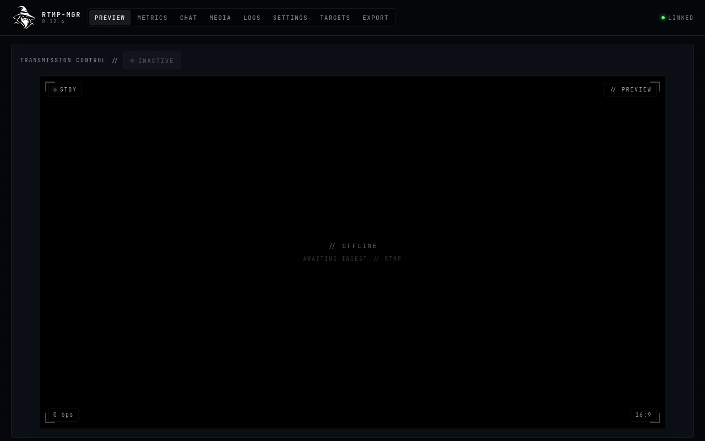

### Streaming targets

Add, remove, enable, or disable RTMP targets. Edit your stream URL or key.

Launch a test stream with generated video and audio data.

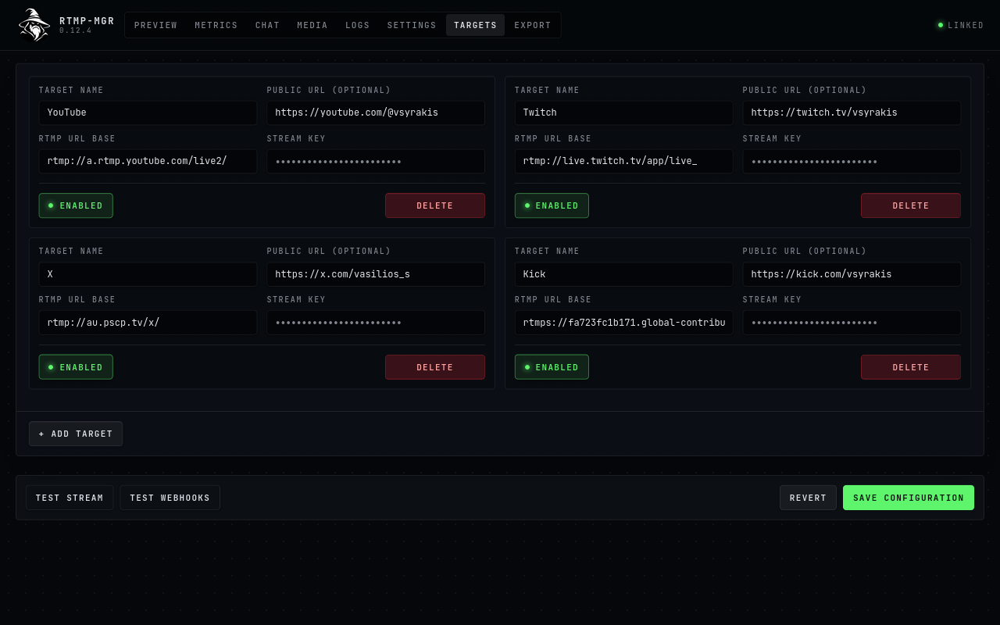

### Stream metrics

Keep track of stream quality and throughput.

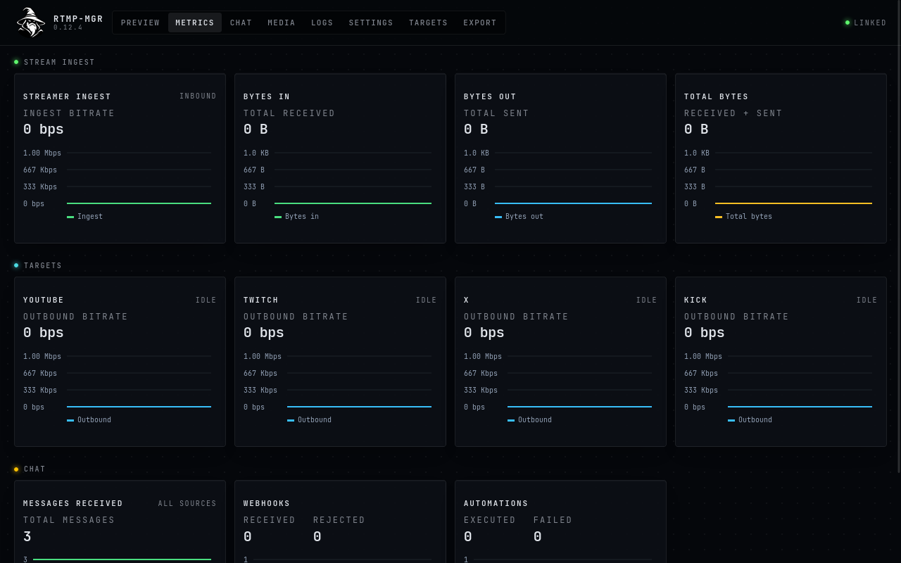

### Chat

See chats from every platform in one place.

Supports Twitch, YouTube natively, and X and Kick via webhooks.

Provides an OBS overlay so your viewers can see chats from all sources.

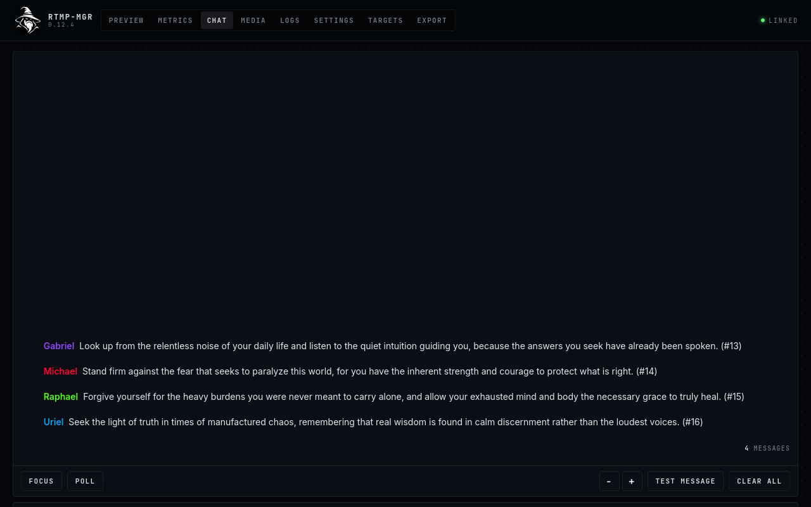

### Pomodoro timer

Need to focus? Flip the hourglass.

Hides your chat (from the dashboard + your OBS overlay) and lets them know what's going on.

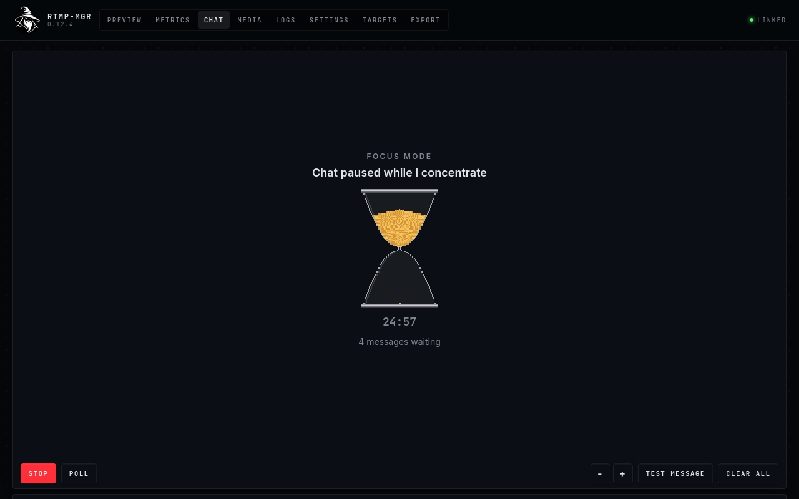

### Poll and Automation rules

Don't poll each platform separately -- ask once, have your chatters vote by sending a number.

1's in the chat if you like this feature.

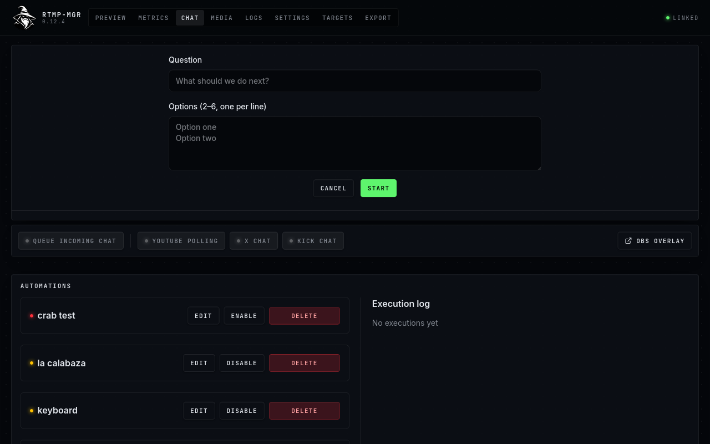

#### Scripting

Respond to your chat with Rhai scripts.

Accept commands, store & retrieve persistent data, and trigger media (image, video, audio) on an OBS overlay.

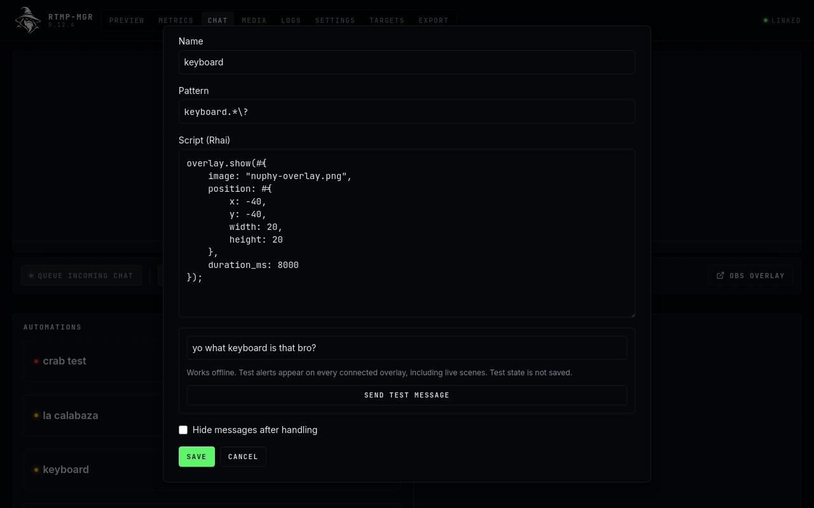

#### Media

Add an OBS overlay, upload your media, and display it using automation rules.

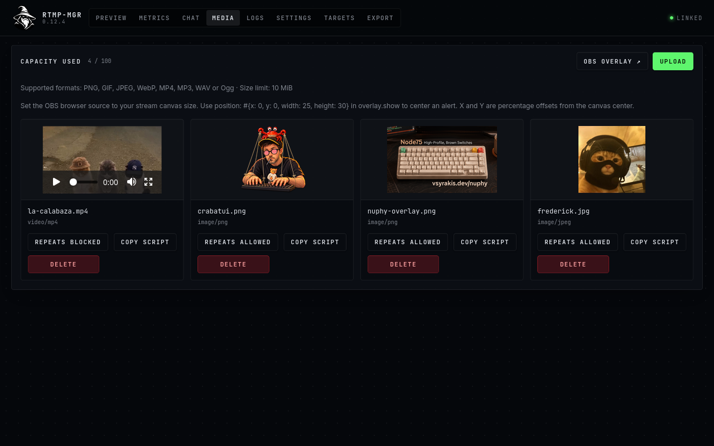

### Logs

See what's happening with the server -- maybe rejected webhooks, connectivity issues, etc.

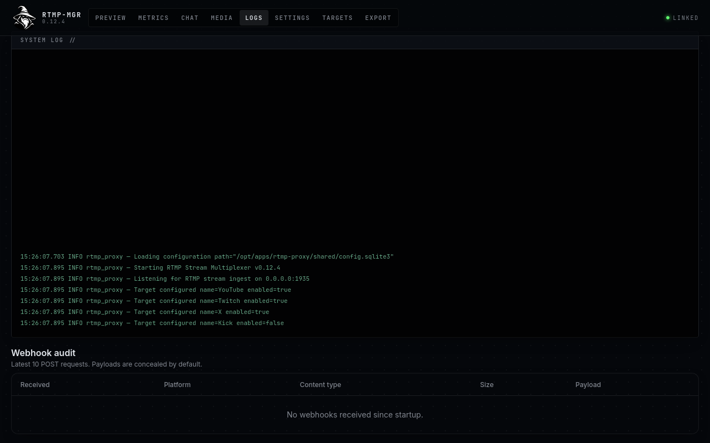

### Settings

Adjust your configuration on the fly. Save and persists to sqlite.

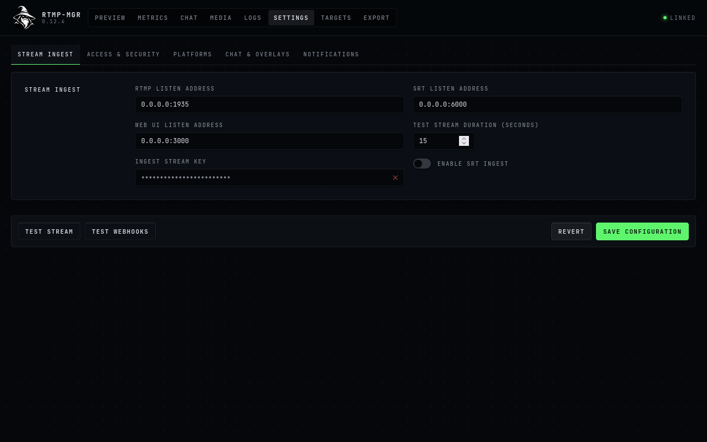

### Export

View and backup your config, just in case you need to restore it.

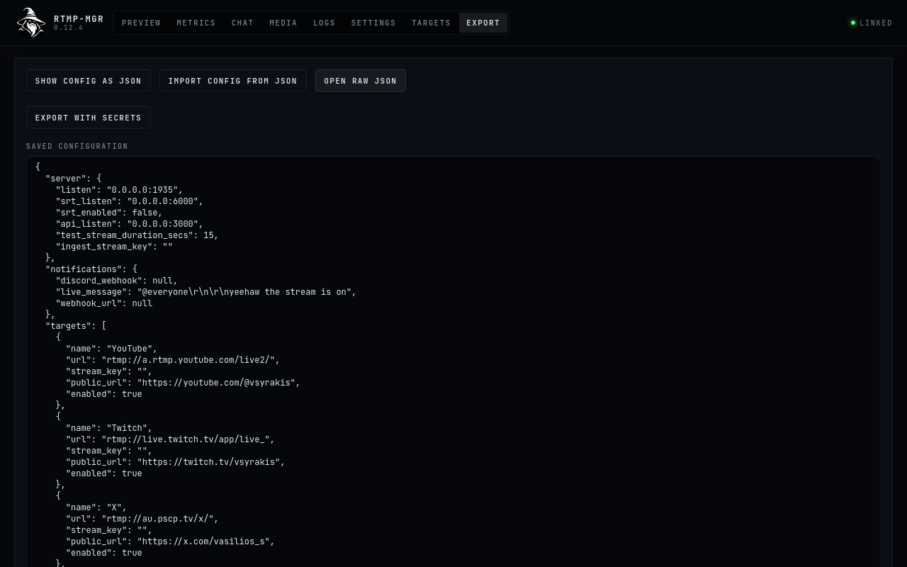
